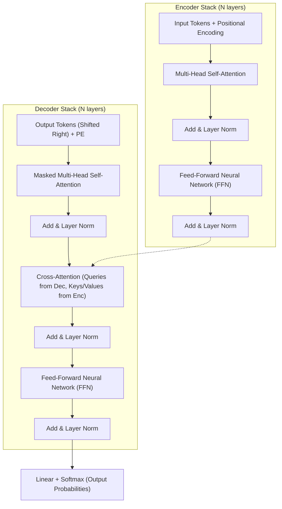

Dưới đây là bản **tổng hợp cô đọng toàn bộ kiến thức cốt lõi của Chapter 7: Transformer and Pre-Trained Language Models** (môn TMG301), tập trung vào bản chất nguyên lý và giữ nguyên toàn bộ **Keywords chuyên ngành**.

---

### 1. Động lực ra đời (Motivation for Transformer)

Trước năm 2017, NLP chủ yếu sử dụng **RNN / LSTM** và **CNN**, nhưng cả hai đều bộc lộ hạn chế lớn:

* **RNNs (Recurrent Neural Networks):**
  * **Sequential Computation:** Phải xử lý từng từ một theo thứ tự thời gian ($t_1 \to t_2 \to \dots$), **không thể tính toán song song (Lack of Parallelization)** trên GPU.
  * **Vanishing / Exploding Gradient:** Khó học và ghi nhớ các mối quan hệ khoảng cách xa (**Long-range Dependencies**).
  * **Bottleneck:** Phải nén toàn bộ ngữ cảnh câu vào một vector trạng thái ẩn cố định (**Hidden State**).
* **CNNs (Convolutional Neural Networks):**
  * Bắt tốt đặc trưng cục bộ (**Local Patterns**), nhưng trường tiếp nhận (**Receptive Field**) bị giới hạn, cần xếp chồng nhiều tầng mới bao quát được phụ thuộc ngữ cảnh ở xa.
* **Transformer (Vaswani et al., 2017 - "Attention Is All You Need"):**
  * Loại bỏ hoàn toàn mạng hồi quy (*Recurrence*) và tích chập (*Convolution*).
  * Dựa hoàn toàn vào **Self-Attention Mechanism** kết hợp **Parallel Processing**, xử lý toàn bộ các từ trong chuỗi cùng một lúc.

---

### 2. Cơ chế Self-Attention (Tự chú ý)

Cơ chế cho phép một từ trong câu xem xét mức độ liên quan và tính toán trọng số chú ý tới **tất cả các từ khác** trong cùng chuỗi, không phụ thuộc vào khoảng cách vật lý giữa chúng.

#### A. Bộ ba vector Query - Key - Value ($Q, K, V$)
Với mỗi từ (đã nhúng thành vector $x$), mô hình nhân với 3 ma trận trọng số học được ($W^Q, W^K, W^V$) để tạo ra:
* **Query ($Q$):** Vector đại diện cho từ hiện tại đang đi "truy vấn" ngữ cảnh xung quanh.
* **Key ($K$):** Vector nhãn/chỉ mục của các từ khác để khớp với Query.
* **Value ($V$):** Vector nội dung/thông tin thực sự mà từ đó sẽ đóng góp nếu được chú ý.

#### B. Quy trình tính Scaled Dot-Product Attention
$$\text{Attention}(Q, K, V) = \text{softmax}\left(\frac{Q K^T}{\sqrt{d_k}}\right) V$$

1. **Attention Scores ($Q \cdot K^T$):** Tích vô hướng đo độ tương đồng giữa Query của từ này với Key của mọi từ khác.
2. **Scaling Factor ($\frac{1}{\sqrt{d_k}}$):** Chia cho căn bậc hai của kích thước vector key $d_k$ để tránh giá trị tích vô hướng quá lớn ở không gian số chiều cao, ngăn hàm Softmax bị bão hòa dẫn đến **Vanishing Gradient**.
3. **Softmax:** Chuẩn hóa các điểm số thành trọng số xác suất (**Attention Weights**) có tổng bằng $1$.
4. **Weighted Context Vectors:** Lấy tổng có trọng số của các vector Value ($V$), tạo ra biểu diễn ngữ cảnh mới cho từng từ.

#### C. Multi-Head Attention (Đa đầu chú ý)
* Thay vì chỉ tính 1 phép attention duy nhất, mô hình chia $Q, K, V$ thành nhiều không gian biểu diễn con (**$h$ attention heads**).
* **Mục đích:** Cho phép mô hình đồng thời nắm bắt nhiều loại quan hệ ngữ nghĩa / ngữ pháp khác nhau (ví dụ: một head chuyên chú ý chủ ngữ - vị ngữ, head khác chú ý đại từ - danh từ thay thế, v.v.).
* Kết quả từ các head được nối lại (**Concat**) và chiếu tuyến tính qua ma trận $W^O$:
  $$\text{MultiHead}(Q, K, V) = \text{Concat}(\text{head}_1, \dots, \text{head}_h) W^O$$

---

### 3. Positional Encoding (Mã hóa vị trí)

* **Vấn đề (Permutation Invariance):** Do Transformer xử lý song song toàn bộ chuỗi cùng một lúc (không duyệt tuần tự như RNN), mô hình hoàn toàn **không biết thứ tự trước/sau** của các từ nếu chỉ nhìn vào word embedding (ví dụ: *"chó cắn mèo"* và *"mèo cắn chó"* sẽ bị xem như nhau).
* **Giải pháp:** Cộng trực tiếp theo từng phần tử (**Element-wise Addition**) vector vị trí $PE$ vào vector Word Embedding ban đầu trước khi đưa vào layer đầu tiên:
  $$x_{\text{input}} = \text{WordEmbedding} + \text{PositionalEncoding}$$
* **Hàm lượng giác (Sinusoidal Encodings):** Dùng các hàm Sine và Cosine ở các tần số khác nhau:
  $$PE_{(pos, 2i)} = \sin\left(\frac{pos}{10000^{2i/d_{\text{model}}}}\right)$$
  $$PE_{(pos, 2i+1)} = \cos\left(\frac{pos}{10000^{2i/d_{\text{model}}}}\right)$$
  * Giúp mô hình dễ dàng học được cả **vị trí tuyệt đối** (*Absolute Position*) lẫn **vị trí tương đối** (*Relative Position*) giữa các token và có thể suy rộng ra các chuỗi dài hơn chuỗi lúc huấn luyện.

---

### 4. Kiến trúc tổng thể Transformer (Architecture)

Mô hình gốc tuân theo mô hình **Encoder - Decoder**:

* **Encoder:**
  * Mỗi layer gồm: **Multi-Head Self-Attention** $\to$ **Add & Layer Normalization (Residual Connection)** $\to$ **Position-wise Feedforward Network (FFN)** $\to$ **Add & Layer Normalization**.
  * Chức năng: Nhìn toàn diện ngữ cảnh hai chiều (**Bidirectional context**) để tạo ra biểu diễn trừu tượng của câu đầu vào.
* **Decoder:**
  * Thêm thành phần **Masked Multi-Head Self-Attention**: Che đi các từ tương lai (**Causal Masking / Look-ahead Masking**) để đảm bảo việc sinh từ tuân theo nguyên tắc tự hồi quy (**Autoregressive** - từ ở bước $t$ chỉ được dựa trên các từ từ $1 \dots t-1$).
  * Thêm **Cross-Attention (Encoder-Decoder Attention)**: Query lấy từ Decoder, còn Key và Value lấy từ đầu ra của Encoder để Decoder đối chiếu thông tin nguồn khi sinh chuỗi đích.

---

### 5. Pre-Trained Language Models (Mô hình ngôn ngữ tiền huấn luyện)

Chiến lược hiện đại: **Pre-training $\to$ Fine-tuning Paradigm**
1. **Pre-training:** Huấn luyện trên kho ngữ liệu khổng lồ không gán nhãn (**Self-supervised Learning**) để học cấu trúc ngữ pháp, ngữ nghĩa, tri thức tổng quát.
2. **Fine-tuning:** Giữ lại trọng số đã học, gắn thêm một head phân loại nhỏ (**Classification Head**) và tinh chỉnh trên tập dữ liệu đặc thù (**Task-specific Data**) với số lượng mẫu nhỏ.

#### Các dòng mô hình tiêu biểu:

| Mô hình | Hãng / Kiến trúc | Đặc điểm cốt lõi (Keywords) | Tác vụ thế mạnh |
| :--- | :--- | :--- | :--- |
| **BERT** | Google (2018) **Encoder-only** | **Bidirectional** (ngữ cảnh 2 chiều). Dùng token `[CLS]` để phân loại câu, `[SEP]` để ngăn cách câu. Tiền huấn luyện với **Masked Language Model (MLM)** & **Next Sentence Prediction (NSP)**. | NLU (Classification, NER, Question Answering, Sentiment). |
| **GPT-3 / GPT-series** | OpenAI **Decoder-only** | **Autoregressive / Left-to-Right**, sinh từ kế tiếp (**Next Token Prediction**). Kích thước khổng lồ (GPT-3 có 175B parameters), năng lực **Few-shot / Zero-shot Learning**. | NLG (Text Generation, Story writing, Dialogue, Creative tasks). |
| **RoBERTa** | Meta (Facebook) | Tối ưu hóa BERT: Bỏ NSP, Dynamic Masking, train lâu hơn với batch size lớn hơn trên lượng data khổng lồ. | Cải thiện hiệu năng trên các bài toán của BERT. |
| **T5** | Google **Encoder-Decoder** | Khung mẫu **Text-to-Text Transfer Transformer** (coi mọi bài toán NLP — tóm tắt, dịch thuật, phân loại — đều là bài toán dịch văn bản sang văn bản). | Đa nhiệm (Translation, Summarization, QA). |
| **XLNet** | Google / CMU | Kết hợp ưu điểm của BERT và Autoregressive thông qua **Permutation Language Modeling**. | Xử lý phụ thuộc ngữ cảnh hai chiều không cần mask. |

---

### 6. Bảng tra cứu nhanh Keywords (Cheat Sheet)

* **Self-Attention:** Tự chú ý giữa các từ trong cùng một câu.
* **Cross-Attention:** Chú ý chéo giữa chuỗi giải mã (Decoder) và chuỗi mã hóa (Encoder).
* **Scaled Dot-Product:** Phép tính tương đồng nhân tích vô hướng có chia tỉ lệ $\sqrt{d_k}$.
* **Multi-Head Attention:** Chia nhỏ không gian chiếu để học đa góc độ quan hệ từ.
* **Positional Encoding:** Bổ sung thông tin thứ tự chuỗi bằng hàm sin/cos (khắc phục điểm yếu Permutation Invariance).
* **Residual Connection & LayerNorm (Add & Norm):** Đường tắt giúp dòng gradient lan truyền ổn định khi mạng có nhiều tầng sâu.
* **Causal / Look-ahead Mask:** Mặt nạ che các token ở tương lai trong Decoder.
* **Contextual Word Embeddings:** Biểu diễn vector của một từ thay đổi linh hoạt theo ngữ cảnh xung quanh nó (khác với Word2Vec/GloVe vốn gán vector cố định).
* **`[CLS]` Token:** Token đặc biệt đặt ở đầu chuỗi BERT, vector đầu ra của nó đại diện cho toàn bộ câu.
* **Downstream Tasks:** Các tác vụ bài toán cụ thể ở giai đoạn sau (Text Classification, NER, Sentiment Analysis, QA, Machine Translation).