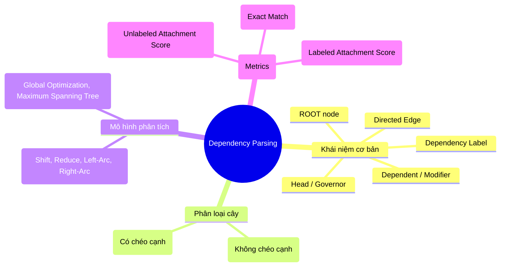

Dưới đây là bản **tổng hợp cô đọng toàn bộ kiến thức cốt lõi Chapter 12: Dependency Parsing** (theo tài liệu môn [TMG301 - Text Mining](file:///g:/My%20Drive/Study/FPT%20University%20AI/Kì%205/Text%20Mining%20(TMG301)/slide%20fpt/12.%20Dependency%20Parsing.ppt)), tập trung làm nổi bật các **Keywords chuyên ngành** phục vụ ôn thi và làm bài tập.

---

# BẢNG TỔNG HỢP KIẾN THỨC CỐT LÕI CHAPTER 12: DEPENDENCY PARSING



---

## 1. Khái niệm cơ bản (Fundamentals)

* **Dependency Parsing** (*Phân tích cú pháp phụ thuộc*): Quá trình phân tích cấu trúc ngữ pháp của câu bằng cách xác định trực tiếp các **mối quan hệ nhị phân có hướng** giữa các từ riêng lẻ (không thông qua các cụm từ ngữ đoạn như Constituency Parsing).
* **Dependency Tree / Directed Graph** (*Cây phụ thuộc / Đồ thị có hướng*):
  * **Nodes (Đỉnh)**: Mỗi từ trong câu là một node.
  * **Directed Edges (Cung có hướng)**: Đi từ từ chi phối đến từ phụ thuộc:
    $$\text{Governor (Head)} \longrightarrow \text{Dependent (Modifier/Child)}$$
  * **Root Node**: Nút gốc (thường là động từ chính / *main predicate* của câu), không phụ thuộc vào bất kỳ từ nào khác.
* **Đặc tính cấu trúc cây chuẩn (Formal Constraints)**:
  * **Acyclic**: Không có chu trình.
  * **Single Head**: Mỗi từ (trừ ROOT) chỉ có duy nhất **một** từ chi phối (Head).
  * **Connected**: Toàn bộ các từ liên kết về cùng một gốc.

---

## 2. Các quan hệ phụ thuộc phổ biến (Key Dependency Relations)

| Label | Tên đầy đủ (Keyword) | Ý nghĩa ngữ pháp | Ví dụ trong câu: *"The cat chased the mouse"* |
| :--- | :--- | :--- | :--- |
| `ROOT` | **Root Predicate** | Động từ/vị ngữ chính của câu | `chased` |
| `nsubj` | **Nominal Subject** | Chủ ngữ danh từ (thực hiện hành động) | `cat` $\leftarrow$ `chased` |
| `dobj` / `obj`| **Direct Object** | Tân ngữ trực tiếp (chịu tác động) | `mouse` $\leftarrow$ `chased` |
| `det` | **Determiner** | Từ hạn định bổ nghĩa cho danh từ | `The` $\leftarrow$ `cat`; `the` $\leftarrow$ `mouse` |
| `amod` | **Adjectival Modifier** | Tính từ bổ nghĩa cho danh từ | *delicious* cake (`delicious` $\leftarrow$ `cake`) |
| `advmod` | **Adverbial Modifier** | Trạng từ bổ nghĩa cho động từ/tính từ | *quickly* ate (`quickly` $\leftarrow$ `ate`) |
| `prep` | **Prepositional Modifier**| Giới từ liên kết | *in* the room (`in` $\leftarrow$ `ate`) |
| `pobj` | **Prepositional Object** | Danh từ đi sau giới từ | in *the room* (`room` $\leftarrow$ `in`) |

---

## 3. Phân loại phân tích phụ thuộc (Types of Dependency Parsing)

### 3.1. Projective Parsing (Cây phân nhánh chiếu / Không chéo cạnh)
* **Định nghĩa**: Một cây phụ thuộc được gọi là **Projective** nếu các cạnh biểu diễn không cắt nhau (**No crossing edges**) khi được vẽ trên cùng một mặt phẳng phía trên câu theo thứ tự từ tuyến tính.
* **Đặc điểm**: Đơn giản, trực quan, phù hợp với hầu hết cấu trúc ngữ pháp thông thường trong tiếng Anh.

### 3.2. Non-Projective Parsing (Cây không chiếu / Có chéo cạnh)
* **Định nghĩa**: Cho phép các cạnh cắt/giao nhau (**Edges cross / intersect**).
* **Ý nghĩa**: Xử lý được các ngôn ngữ có trật tự từ tự do (**free word order languages** như tiếng Đức, Séc, Latin) hoặc các cấu trúc ngữ pháp đảo ngữ, phụ thuộc khoảng cách xa (**long-distance dependencies**).

---

## 4. Hai phương pháp phân tích cú pháp (Parsing Approaches)

### 4.1. Transition-based Dependency Parsing (Dựa trên chuyển trạng thái)
* **Cơ chế**: Hoạt động như một máy chuyển trạng thái theo trình tự (**State Machine / Shift-Reduce Paradigm**).
* **Thành phần trạng thái (State/Configuration)**:
  1. **Stack**: Ngăn xếp lưu các từ đang được xét.
  2. **Buffer / Input Queue**: Hàng đợi lưu các từ chưa đọc tới của câu.
  3. **Set of Arcs**: Tập hợp các cạnh quan hệ phụ thuộc đã được tạo ra.
* **4 Hành động chuyển đổi (Transition Actions)**:
  * **Shift**: Đẩy từ tiếp theo từ Buffer vào Stack.
  * **Reduce**: Lấy từ ở đỉnh Stack ra ngoài (khi từ đó đã tìm xong Head và Dependents của nó).
  * **Left-Arc ($LA_r$)**: Tạo cạnh có nhãn $r$ hướng sang trái: $\text{Head (bên phải)} \rightarrow \text{Dependent (bên trái)}$, sau đó loại bỏ (*pop*) Dependent ra khỏi Stack.
  * **Right-Arc ($RA_r$)**: Tạo cạnh có nhãn $r$ hướng sang phải: $\text{Head (bên trái)} \rightarrow \text{Dependent (bên phải)}$, sau đó đẩy (*push*) Dependent vào Stack.
* **Ưu / Nhược điểm**:
  * $\bf{+}$ Rất nhanh, độ phức tạp thời gian tuyến tính $\mathcal{O}(n)$.
  * $\bf{-}$ Dễ gặp lỗi tích lũy (**error propagation**) do quyết định greedy cục bộ (*local decisions*).

---

### 4.2. Graph-based Dependency Parsing (Dựa trên tối ưu hóa đồ thị)
* **Cơ chế**: Quy về bài toán tối ưu hóa toàn cục (**Global Graph Optimization** / **Maximum Spanning Tree - MST**).
* **Quy trình**:
  1. Biểu diễn câu thành một đồ thị đầy đủ có hướng: mỗi cặp từ đều có một cạnh tiềm năng kèm trọng số / điểm số (**scoring function**).
  2. Tìm cây hợp lệ có tổng điểm số các cạnh là lớn nhất:
     $$\hat{T} = \arg\max_{T \in \mathcal{T}} \sum_{(i, j) \in T} \text{Score}(w_i, w_j)$$
* **Thuật toán sử dụng**:
  * **Eisner Algorithm**: Dành cho bài toán Projective (dùng Dynamic Programming, độ phức tạp $\mathcal{O}(n^3)$).
  * **Chu-Liu-Edmonds Algorithm**: Tìm MST trên đồ thị có hướng cho Non-projective ($\mathcal{O}(n^2)$).
* **Ưu / Nhược điểm**:
  * $\bf{+}$ Đạt nghiệm tối ưu toàn cục (**globally optimal**), không bị phụ thuộc vào thứ tự bước đi trước.
  * $\bf{-}$ Chi phí tính toán cao hơn ($\mathcal{O}(n^2) - \mathcal{O}(n^3)$).

---

## 5. Thang đo đánh giá (Evaluation Metrics)

| Chỉ số | Tên đầy đủ (Keyword) | Công thức tính | Ý nghĩa ngắn gọn |
| :--- | :--- | :---: | :--- |
| **UAS** | **Unlabeled Attachment Score** | $\displaystyle\frac{\text{Correctly Attached Words}}{\text{Total Words}} \times 100\%$ | Chỉ cần tìm **đúng Head** (bỏ qua nhãn quan hệ). |
| **LAS** | **Labeled Attachment Score** | $\displaystyle\frac{\text{Correctly Attached \& Labeled Words}}{\text{Total Words}} \times 100\%$ | Phải tìm **đúng cả Head VÀ đúng Label** ($LAS \le UAS$). |
| **EM** | **Exact Match** | $\displaystyle\frac{\text{Fully Correct Sentences}}{\text{Total Sentences}} \times 100\%$ | Toàn bộ câu phải đúng $100\%$ cả Head và Label. |

---

## 6. Implementation với thư viện `spaCy` (Python Code Snippet)

Trong thực hành và đề thi lab/practical, bài toán thường sử dụng thư viện `spaCy`:

```python
import spacy
from spacy import displacy

# 1. Load pipeline mô hình ngôn ngữ
nlp = spacy.load("en_core_web_sm")

doc = nlp("The cat chased the mouse.")

# 2. Duyệt qua từng token lấy Head và Dependency Label
for token in doc:
    print(f"{token.text:<8} -> dep: {token.dep_:<8} | head: {token.head.text}")

# 3. Trực quan hóa cây đồ thị phụ thuộc
# displacy.render(doc, style="dep", jupyter=True)
```

---

## 7. Bảng Cheat-Sheet Keywords cốt lõi để đi thi

* **Syntactic Dependencies**: Quan hệ phụ thuộc cú pháp.
* **Head / Governor**: Từ chi phối.
* **Dependent / Modifier / Child**: Từ phụ thuộc.
* **Projective**: Không chéo cạnh vs. **Non-Projective**: Cắt chéo cạnh (*crossing edges*).
* **Transition-based Actions**: `Shift`, `Reduce`, `Left-Arc`, `Right-Arc`.
* **Graph-based Parsing**: Mô hình tối ưu đồ thị toàn cục (**MST - Maximum Spanning Tree**).
* **UAS vs. LAS vs. EM**: 3 thang đo đánh giá độ chính xác (UAS chỉ xét Head, LAS xét cả Head và Label, EM xét độ chính xác toàn bộ câu).